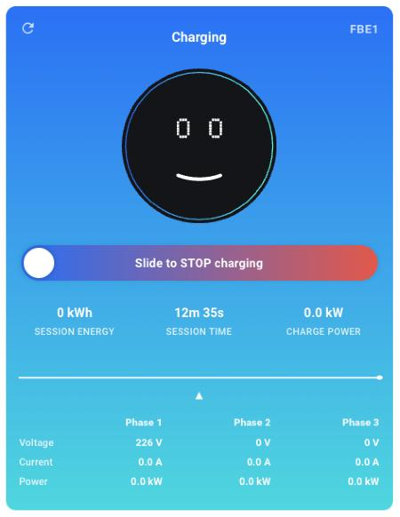

# Voltie Charger Card

Lovelace card for the Voltie Charger Home Assistant integration.

[](https://hacs.xyz)
[](LICENSE)

Works with the Voltie Charger integration, both the custom one ([voltie-eu/homeassistant-voltie_charger](https://github.com/voltie-eu/homeassistant-voltie_charger)) and the one built into Home Assistant.

| Integration | Card needed |
| --- | --- |
| v0.3.0 and older | any version |
| v0.4.0 | v0.4.0 or newer |
| v0.5.0 and the built-in integration | v0.5.0 or newer |

Update the card first, then the integration.

## Features

- Status panel with state-dependent colors and illustrations (offline, idle, plugged in, charging, fault).
- Slider to start and stop charging. The UI flips immediately and reconciles with the real state once the charger responds.
- Power sparkline of the current charging session, including idle gaps between charging periods.
- Expandable drawer with per-phase voltage, current and power, DLM and IPM readings, and a per-period energy breakdown where the integration provides it. Without per-phase sensors it shows the charger totals.
- Fault view driven by the charger's Problem sensor, with help text for documented EVSE faults.
- Visual editor.

## Screenshots



## Installation 📦

### Home Assistant Marketplace or HACS

Once the card is listed in the HACS default catalog, search for `Voltie Charger Card` in HACS or in the Marketplace built into Home Assistant (2026.11 or newer), and install it.

Until then, add it to HACS as a custom repository:

1. Open **HACS** in the sidebar.
2. Open the **⋮** menu → **Custom repositories**.
3. Fill in the dialog:
   - **Repository:** `https://github.com/voltie-eu/lovelace-voltie-charger-card`
   - **Type:** **Dashboard**
4. Click **Add**.
5. Search for `Voltie Charger Card`, click the result, click **Download**.
6. Confirm the latest version and click **Download** again.
7. Hard-refresh the browser (⌘/Ctrl + Shift + R).

HACS handles updates for you. No Home Assistant restart is needed for cards.

### Manual

1. Download `voltie-charger-card.js` from the [latest release](https://github.com/voltie-eu/lovelace-voltie-charger-card/releases/latest).
2. Copy it to the `www` folder of your Home Assistant configuration directory (create the folder if it does not exist).
3. Go to **Settings** → **Dashboards**, open the **⋮** menu → **Resources**. (The menu item needs **Advanced mode** in your user profile.)
4. Click **Add resource**, enter the URL `/local/voltie-charger-card.js`, select **JavaScript module** and click **Create**.
5. Hard-refresh the browser (⌘/Ctrl + Shift + R).

To update, replace the file and change the resource URL to `/local/voltie-charger-card.js?v=0.5.0` (the new version number), so browsers load the new file.

## Adding the card

1. Open the dashboard where you want the card.
2. Click **Edit dashboard** in the top right corner.
3. Select where you want to add the card.
4. Search for `Voltie` and pick **Voltie Charger**.
5. Select your charger in the **Voltie Charger device** dropdown.
6. Click **Save**, then **Done** to exit edit mode.

## Configuration

| Option | Type | Default | Description |
| --- | --- | --- | --- |
| `device_id` | string | *required* | HA device id of the charger. |
| `name` | string | device name | Display-name override. |
| `show_power_graph` | boolean | `true` | Power sparkline while in session. |
| `show_advanced` | boolean | `true` | Drawer with per-phase data (or totals) and periods. |
| `debug` | boolean | `false` | Verbose logs in the browser console. |

Minimal YAML:

```yaml
type: custom:voltie-charger-card
device_id: 0123456789abcdef0123456789abcdef
```

## Per-phase readings

From integration v0.5.0, and in the built-in integration, the per-phase voltage, current and power sensors and the DLM and IPM currents are disabled by default. The drawer then shows the charger's voltage, current, power and active phases instead.

To see each phase:

1. Go to **Settings** → **Devices & services** → **Voltie Charger** and open your charger.
2. Under **Diagnostic**, open the entities that are not shown.
3. Select a per-phase sensor (for example **Current L1**), open its settings, turn on **Enabled** and click **Update**.
4. Repeat for the other phases. Home Assistant adds them within about 30 seconds.

The card shows a row as soon as one of its sensors is enabled, and a dash for phases that are still disabled.

## Building

A prebuilt bundle ships with every release, so you don't need to build it yourself to use the card. To build from source:

```sh
npm install
npm run build
```

## Troubleshooting 🛠️

**"Choose a charger".** The card has no device selected. Open the card editor and pick one.

**"Can't reach Home Assistant's entity registry".** WebSocket hiccup; the card retries. If it sticks, reload the page.

**Card shows "offline" but the charger is online.** Check the charger's **Charging enabled** switch in **Developer tools** → **States**. If it's `unavailable`, the integration is the issue, not the card.

**Card shows "offline" right after updating the integration.** Update this card to the version in the table at the top and hard-refresh the browser. Older cards cannot find the entities of newer integration releases.

**The drawer shows totals instead of phases.** The per-phase sensors are disabled. See [Per-phase readings](#per-phase-readings).

## Changes in 0.5.0

- Works with integration v0.5.0 and the built-in integration.
- Reads the new unique ID format (`<charger_id>_<key>`); older formats still work.
- No longer needs the removed state attributes (`raw_code`, `periods`, `error`).
- Faults come from the Problem sensor, so unknown fault codes show too.
- Per-phase, DLM and IPM sensors are optional; the drawer falls back to totals.
- Release builds attach `voltie-charger-card.js` to the GitHub release.

## License

Apache License 2.0. Copyright 2026 Voltie. See [LICENSE](LICENSE).
